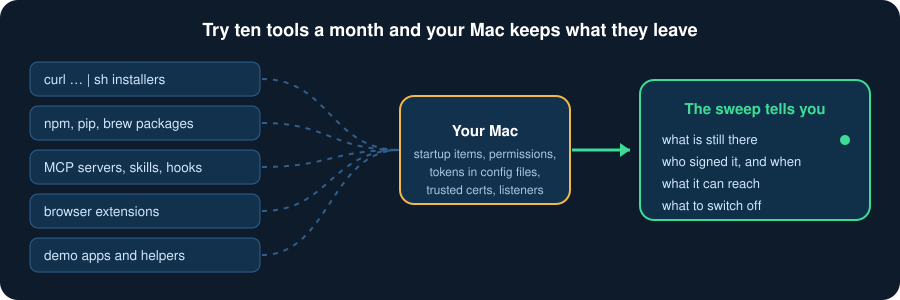
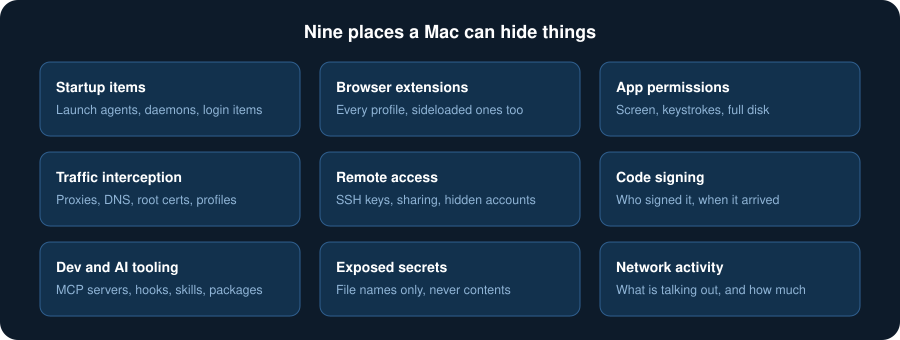
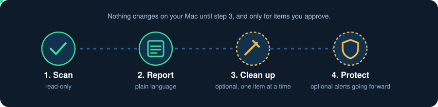
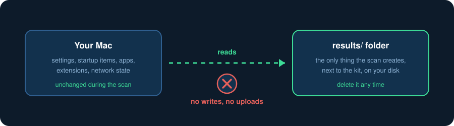

<p align="center">
  
</p>

<p align="center">
  <a href="https://github.com/stuinfla/mac-agentic-security-sweep/releases/latest/download/Mac-Claude-Security-Sweep.zip"><b>⬇ Download the zip</b></a>
  &nbsp;·&nbsp; macOS 13+ &nbsp;·&nbsp; free &nbsp;·&nbsp; MIT license &nbsp;·&nbsp; version 2
</p>

**Mac Agentic Security Sweep** is a kit that lets Claude check your Mac for the things that quietly go wrong: programs that start themselves, browser extensions you did not choose, apps holding powerful permissions, traffic being redirected, remote-access back doors, and secrets lying around in config files. It looks, explains what it found in plain language, and only changes something if you say yes, one item at a time, with an undo.

You do not need to be a security person. You paste one line into Terminal and answer questions.

## Who it is for

Anyone who wants a calm second opinion on their Mac. It is especially useful if you are an **agentic engineer**: someone who installs new CLIs, MCP servers, skills, hooks, npm and pip packages, and `curl | sh` installers every week, and lets AI agents run commands on a machine that holds API keys.

<p align="center"></p>

Each of those experiments can leave something behind that outlives the experiment: a launch agent, a helper tool, a root certificate, a token in a dotfile, an extension, a permission you clicked through. A sweep every few months, and after anything you were unsure about, is cheap insurance.

## What it checks

<p align="center"></p>

Every finding is labelled **Confirmed**, **Likely** or **Unknown**, with the exact evidence line. Before calling anything harmless or malicious, Claude is told to look for evidence that would prove it wrong: dates, signer, whether it is running right now. Findings are split into **compromise indicators** (these raise an alert) and **hardening gaps** such as FileVault being off or macOS being out of date (these go in the report, without scaring you).

## How it works

<p align="center"></p>

1. **Scan.** Read-only. The scripts collect facts. Claude (in Claude Code) reads them, digs into anything odd, and stops to alert you right away if it finds something serious.
2. **Report.** A short plain-language report: verdict, alerts, things worth fixing, what looked fine, what could not be checked, and the one most important next step.
3. **Clean up (optional).** One item at a time. For each: what it is, the evidence, the exact action, what could break, how to undo. Nothing happens without your yes. Items are moved into a `quarantine/` folder with an undo script. Nothing is deleted.
4. **Protect (optional).** Claude can walk you through two free tools from [Objective-See](https://objective-see.org), LuLu and BlockBlock, which alert you to new outgoing connections and new startup items from then on.

## Why it is safe to run

<p align="center"></p>

You should not take that on trust, so each claim here is something you can check in a minute.

| Claim | How you can verify it |
|---|---|
| The scripts are plain text you can read | `sudo-checks.sh`, `collect-checks.sh` and `quarantine.sh` are short bash. Open them. |
| The scan only reads | It writes only into the `results/` folder next to the kit. Run `grep -nE '\b(rm\|mv\|chmod\|chown\|kill\|defaults write)\b' collect-checks.sh sudo-checks.sh`. You should see only: `kill` (stops the script's own timeout timer), `mv` (renames an earlier results folder to `-prev`) and `chown` (hands `results/` back to you). Nothing touches the rest of your Mac. |
| The scripts never upload anything | Run `grep -nE '(^\|[;&\|(] *)(curl\|wget\|nc\|scp\|sftp\|rsync\|ssh)( \|$)' collect-checks.sh sudo-checks.sh`. It matches one line, a *search pattern* the script uses to spot `curl` in your launch agents, not a command it runs. |
| The one script that needs your password is read-only | You run `sudo bash sudo-checks.sh` yourself and can read it first. Claude is told never to run `sudo` itself and never to edit these scripts. |
| Secrets are masked | API keys, tokens, JWTs and private keys are redacted in the output, and the credential check lists **file names only**, never contents. |
| Cleanup cannot wreck your Mac | `quarantine.sh` only moves items inside an **allow-list** (your launch agents, third-party launch daemons and helpers, apps, native-messaging hosts, AI-tool skill folders). It refuses system files, `sudoers`, `pam.d`, login plugins, your Documents and everything else. Genuine Apple-signed apps are refused. |
| Every cleanup is reversible | Moves are recorded in `quarantine/UNDO.sh` (or `UNDO-system.sh` for system items). The undo skips anything already back in place. |
| Claude asks before it acts | Claude Code asks you to approve commands. The kit tells you to approve only plain read commands in bulk, never `rm`, `sudo`, `launchctl`, `kill` or installs. |
| Nothing in the kit phones home | There is no telemetry, analytics or auto-update. The scripts send none of your data anywhere. |

### What leaves your Mac, honestly

The scripts send none of your data anywhere. Two checks ask Apple's servers about software updates and app approval, which is normal macOS behaviour. But the point of the kit is that **Claude reads the results**, so what Claude reads goes to Anthropic as part of your conversation, like anything else you give Claude. That is why the scripts redact secrets and why the kit tells you to skim the results before you share them. Only run it in your own Claude account, and delete `results/` when you are done.

### What it is not

It is not antivirus and it cannot prove a Mac is clean. Some modern Mac malware runs once, takes passwords and cookies, and leaves almost nothing behind. A good result reads **"no indicators found"**, not "clean". The kit also cannot defend against an already-compromised Claude Code setup; if you suspect that, run **Path B** from a chat on claude.ai on another device. If a High finding is confirmed as malicious, it will tell you plainly when erasing and reinstalling macOS is the safer move.

## What it does for you

- Finds startup items, extensions and permissions you forgot you granted, and tells you who signed them and when they arrived.
- Flags interception setups (proxies, DNS, extra root certificates, configuration profiles) that would make everything else untrustworthy.
- Spots exposed API keys and tokens by file name, so you can rotate them at the provider.
- Checks the basics: macOS support status and updates, FileVault, firewall, auto-login, backups.
- Gives you a short report and one clear next step instead of 200 lines of output.
- Walks you through fixing what you approve, with an undo for each change.

## Quick start

You need a Mac on macOS 13 or later, your admin password, 30 to 60 minutes, and [Claude Code](https://code.claude.com/docs/en/setup) with a paid Claude plan. No Claude Code? **Path B** in `START-HERE.md` works from a normal Claude chat.

1. **Give Terminal Full Disk Access.** System Settings → Privacy & Security → Full Disk Access → **+** → Applications → Utilities → **Terminal**. Then quit Terminal with ⌘Q.
2. **Download** `Mac-Claude-Security-Sweep.zip` from [Releases](https://github.com/stuinfla/mac-agentic-security-sweep/releases/latest) and leave it in your Downloads folder.
3. **Open Terminal**, paste this one line, press Return:

```bash
cd ~ && claude "Find Mac-Claude-Security-Sweep in my Downloads folder (zip or already-unzipped folder), unpack it into my home folder as ~/mac-claude-security-sweep, then read START-HERE.md and AUDIT-BRIEF.md and run the sweep from Phase 0. Scan read-only; change nothing unless I approve it item by item in the cleanup step."
```

Claude takes it from there. When you are done, turn Terminal's Full Disk Access back off and delete the `results` folder.

### Check your download

```bash
shasum -a 256 ~/Downloads/Mac-Claude-Security-Sweep.zip
```

It should print:

```
bdaa3083b3ff9b9e2c2d76fcc0092d2891aa9e1c2b772dedc1c26e315312cf1a
```

A matching fingerprint proves the file was not damaged or swapped in transit. It does not replace reading the scripts. They are short, and the whole point is that you can.

## What is in the kit

| File | Purpose |
|---|---|
| `START-HERE.md` | Plain-language guide for you |
| `AUDIT-BRIEF.md` | The instructions Claude Code follows, phase by phase |
| `SWEEP-CHECKLIST.md` | Every check, what is suspicious, what is normal, how serious it is |
| `CLEANUP-PLAYBOOK.md` | How each kind of problem is fixed, gentlest option first, with undo |
| `CHAT-PROMPT.md` | Prompt for Path B, a regular Claude chat |
| `collect-checks.sh` | Read-only collector, no password needed |
| `sudo-checks.sh` | Read-only admin checks, run by you with `sudo` |
| `quarantine.sh` | Cleanup helper: moves, never deletes, records the undo |

## Status and feedback

Version 2 was reviewed independently by two AI reviewers and its scripts were tested with planted fake secrets and hostile filenames, but not every check has been run on every macOS version. Treat it as a careful checklist and not as professional forensic software, and ask a professional if you are unsure. Issues and pull requests are welcome, especially reports of a command that behaves differently on your macOS version.

## License

MIT. See [LICENSE](LICENSE).
